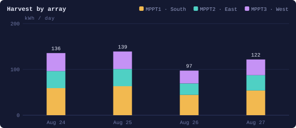
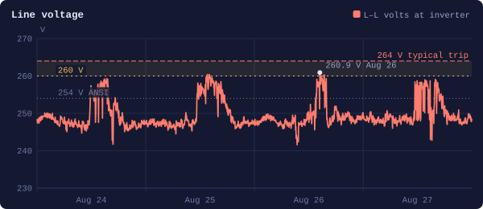

# EG4 Solar Report for Home Assistant

**Is my solar system healthy?** This integration answers that in plain English.

It downloads your EG4 inverter's own log from the **EG4 Monitor Center** (the same data you can export from the
website), runs **21 checks** on it, and tells you **Healthy**, **Watch** or **Act**, with what it found and what to do
about it. It works on today or on the last 7 days, runs on a schedule if you want, and can run itself after a power outage.

> **Beta (0.1.0).** Built and tested against real FlexBOSS 21 logs. Other EG4 models should work but haven't been tried
> yet. Please [open an issue](https://github.com/papac0rn/ha-eg4-solar-report/issues) if something looks wrong.

## What it tells you

A real example, from a 4-day stretch where one battery pack had dropped offline:

> **ACT.** Needs attention this stretch. 494 kWh harvested, 95.6 % self-supplied, zero faults.
>
> - 🔴 **Battery pack offline: 3 of 4 packs.** The discharge limit read 600 A instead of 800 A until 12:49 on Aug 26,
>   when the missing pack rejoined.
> - 🔴 **Grid voltage, every sunny day.** Over 254 V for hours each afternoon while exporting, peaking at 260.9 V.
> - 🟡 **Airflow/fan on heatsink 1.** Overnight, with no solar, heatsink 1 sits 10 °F warmer than the other two.
> - 🟡 **16 kW AC clipping.** The inverter sat at its output ceiling on sunny afternoons.

Every report also has a stat grid (harvest per MPPT, house load, export, import, value, battery, grid volts, heatsink),
an alarm panel, a temperature panel, a day-by-day table, seven charts, and a numbered "What to do" list.

## Install (about 10 minutes)

**You need:** Home Assistant with [HACS](https://hacs.xyz/docs/use/download/download/) installed, and the email and
password you use for the [EG4 Monitor Center](https://monitor.eg4electronics.com) website.

1. **Add it to HACS.** Click the **Open your Home Assistant instance** button at the top of this page, then **Add**.
    (Or in HACS: ⋮ menu → **Custom repositories** → paste `https://github.com/papac0rn/ha-eg4-solar-report`,
   type **Integration** → **Add**.)
2. **Download it.** In HACS, open **EG4 Solar Report** → **Download** → **Download**.
3. **Restart Home Assistant.** Settings → ⋮ (top right) → **Restart Home Assistant**.
4. **Set it up.** Click the **start setting up** button at the top of this page.
    (Or Settings → Devices & services → **+ Add integration** → search **EG4 Solar Report**.)
5. **Sign in** with your EG4 Monitor Center email and password, then click through the screens. Most answers are
   filled in for you. See the [Setup Guide](https://github.com/papac0rn/ha-eg4-solar-report/wiki/Setup-Guide) for
   what each one means.
6. **Make the dashboard.** Settings → Devices & services → EG4 Solar Report → your station → press **Create Dashboard**.
   A **Solar Report** page appears in the sidebar.
7. **Run your first report.** On that page, press **Generate Report**. It takes about half a minute.

Step-by-step pictures and answers to common problems are in the **[wiki](https://github.com/papac0rn/ha-eg4-solar-report/wiki)**.

## Already have the EG4 Web Monitor integration?

Good: keep it. The two work together. This one reads your battery size, pack count and SOC floor straight from that
integration's sensors, and both use the same `pylxpweb` library at compatible versions.

## The 21 checks

Each check is rated **OK**, **Info** (worth knowing), **Watch** (keep an eye on it) or **Act** (needs attention).

| Group | Checks |
|---|---|
| Grid | Outages and blips · Transient-failure signature (W016–W018) · High grid voltage · Low grid voltage · Grid frequency |
| Battery | Pack-dropout signature (W004 + W027) · All packs online · Cell balance · Cell voltage limits · Cell temperature · State of health · Grid carrying load while the battery sits out |
| Inverter | Fault codes · Warning codes · Heatsink temperature · Output ceiling · MPPT current · PV string voltage |
| Arrays | Array balance (weather vs. array problem) |
| Data | Logger gaps · Energy counter cross-check |

Fault and warning codes are decoded into plain language and judged **one-off** (cleared on its own, often during a grid
blip) or **repeating**. Codes it doesn't know are flagged Watch, never ignored. Details are on the
[Checks Explained](https://github.com/papac0rn/ha-eg4-solar-report/wiki/Checks-Explained) wiki page.

The report only sees what the inverter logs. Limits such as the 264 V trip point are typical values; check them
against your own inverter settings.

## For dashboard builders and automations

- `sensor.<station>_report`: state is `healthy`, `watch`, `act` or `error`. Its attributes hold the whole report:
  `summary`, `chips`, `stats`, `mppt`, `alarms`, `temperatures`, `daily`, `totals`, `findings`, `checks`, `codes`,
  `actions`.
- `binary_sensor.<station>_action_needed`: on for Act or a failed run.
- `select.<station>_report_period`, `date.<station>_report_end_date`, `button.<station>_generate_report`,
  `sensor.<station>_last_generated`.
- Seven chart images, `image.<station>_chart_harvest`, `_energy`, `_pv_ac`, `_grid_voltage`, `_soc`, `_cell_voltage` and
  `_temperatures`, redrawn every run. Show them with the built-in **Picture entity** card.
- Service `eg4_solar_report.generate` (optional `period`, `end_date`).
- Event `eg4_solar_report_generated` with `verdict`, `range`, `counts` and `new_findings`.

See the [Dashboard Guide](https://github.com/papac0rn/ha-eg4-solar-report/wiki/Dashboard-Guide) for examples.

## Privacy and disclaimer

- Your EG4 login is stored only in your Home Assistant, like any other integration's login. Reports stay in your
  Home Assistant. **Download diagnostics** hides your login, station and serial numbers.
- This uses **unofficial** access to the EG4 Monitor Center. It is not affiliated with or endorsed by EG4 Electronics,
  and it may break if EG4 changes their website.

## Credits

- [pylxpweb](https://github.com/joyfulhouse/pylxpweb) by joyfulhouse, for the Monitor Center client, the export
  parser and the fault and warning code names
- [EG4 Web Monitor](https://github.com/joyfulhouse/eg4_web_monitor) by joyfulhouse. When it's installed, this report reads
  your battery size, pack count and SOC floor from its sensors, and can sign in with its EG4 account. If you use EG4 with
  Home Assistant, you probably want it too.
- Built with [Claude Code](https://claude.com/claude-code)

## License

MIT
